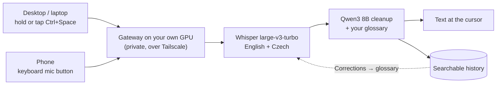
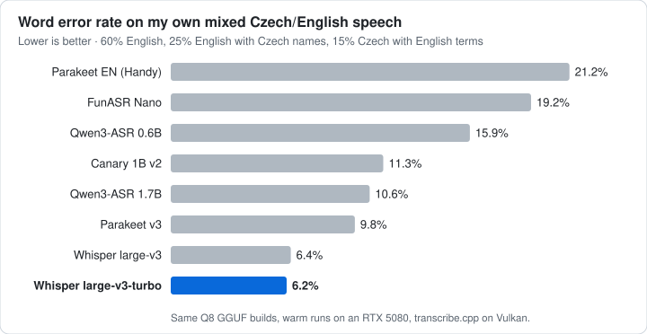
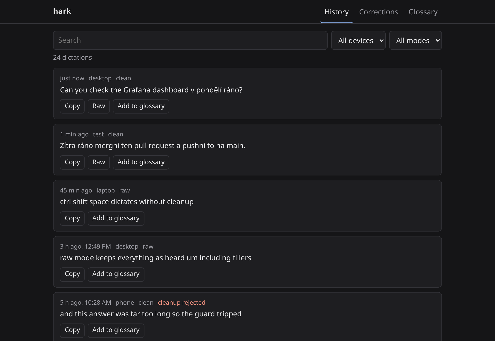
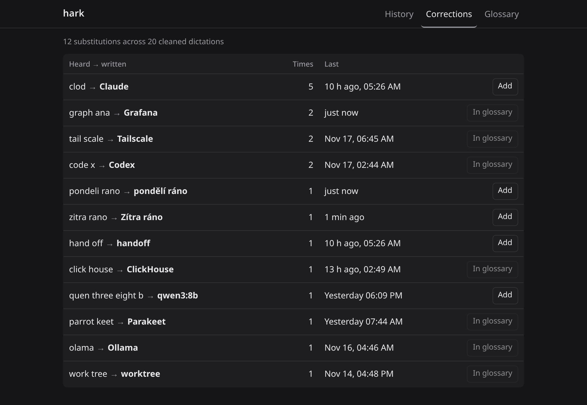

# hark

**Self-hosted dictation for people who talk in two languages at once.**
Speak on a laptop, desktop or phone, in English, Czech, or both in one
sentence. Clean text lands at your cursor about half a second later.



## Why I built it

Every app I tried broke on how I actually talk: English sentences full of
Czech names, Czech sentences full of English dev slang (*mergni ten PR*,
*pushni to na main*), and product names no general model knows.

| | Before | hark |
|---|---|---|
| **Desktop** | Handy with its English model: local, no history | same hotkeys, server-side, history |
| **Laptop and phone** | nothing usable (the laptop has no GPU) | the same pipeline as the desktop |
| **Mixed Czech + English** | English model writes Czech as gibberish | language detected per recording, never translated |
| **Names and jargon** | no glossary, or one that gets ignored | glossary with "heard as" hints that grows from your own mistakes |
| **Privacy** | cloud apps, or local to one machine | your GPU, your tailnet, **no audio ever stored** |

## Picking the model: measured, not guessed

I recorded my own mixed sentences and benchmarked 10 speech models on them.
The chart shows the main ones. The score is
weighted 60% English, 25% English with Czech names and 15% Czech with
English terms. Lower is better:



| Model | Word error rate | Czech names spelled right in English sentences | Warm latency |
|---|---:|---:|---:|
| Parakeet EN 0.6B (what Handy uses) | 21.2% | 2 of 13 | 0.04 s |
| Parakeet v3 0.6B (multilingual) | 9.8% | 3 of 13 | 0.04 s |
| Whisper large-v3 | 6.4% | 11 of 13 | 0.19 s |
| **Whisper large-v3-turbo** | **6.2%** | **11 of 13** | **0.09 s** |

Turbo is as accurate as the full large-v3 model at half the latency. With
cleanup, a sentence takes about **0.4 s** end to end on an RTX 5080.

## What's special

- **Two languages, one sentence.** Whisper detects English or Czech for each
  recording. If it guesses a third language, the gateway decodes again
  restricted to the two you allow. When the guess is Czech, it also tries
  English and keeps whichever decode is more confident.
- **A glossary that learns.** Write `Kubernetes: cooper netties` and both the
  speech model and the cleanup model learn what that sound means. The
  **Corrections** page mines your history for repeated fixes, and one click
  adds them to the glossary.
- **Cleanup that doesn't overreach.** A local Qwen3 8B fixes punctuation,
  numbers and filler words, with reasoning off (about 0.3 s). It never
  translates, keeps hedges like *"I think"*, keeps Czech-English hybrids like
  *mergni* as spoken, and restores missing Czech diacritics. If an answer
  drifts too far from what you said, the gateway returns the raw transcript.
  The transcript is wrapped so the model can't mistake "what's the capital of
  France?" for a question meant for it.
- **One key, every device.** On KDE Wayland, tap Ctrl+Space to toggle or hold
  it to talk; Ctrl+Shift+Space gives raw text. The text is pasted at the
  cursor and your clipboard is restored afterwards. On Android, the keyboard's
  own mic button routes to hark, with an optional floating mic bubble.
- **Any client works.** The gateway speaks OpenAI's
  `/v1/audio/transcriptions`. The `model` field picks a mode (`clean`, `raw`
  or your own prompt in `modes.toml`).

## History and corrections

Every dictation is saved as text only (SQLite full-text search), with the raw
transcript next to the cleaned one.

<picture>
  <source media="(prefers-color-scheme: light)" srcset="docs/images/history-light.png">
  
</picture>

<picture>
  <source media="(prefers-color-scheme: light)" srcset="docs/images/corrections-light.png">
  
</picture>

## What's inside

| Part | Stack | Docs |
|---|---|---|
| `server/` | Python (stdlib HTTP), [transcribe.cpp](https://github.com/handy-computer/transcribe.cpp) on Vulkan (NVIDIA or AMD), Ollama, SQLite FTS5 | [server/README.md](server/README.md) |
| `linux/` | Rust: KDE global shortcuts, PipeWire capture, paste at the cursor, recording overlay | [linux/README.md](linux/README.md) |
| `android/` | Kotlin, no native code: system voice input, optional mic bubble | [docs/android.md](docs/android.md) |
| `docs/api.md` | the HTTP contract between them | [docs/api.md](docs/api.md) |
| `server/bench/` | the speech-model benchmark above | [server/bench/README.md](server/bench/README.md) |

## Run it

1. **Server:** on a machine with a GPU, install Ollama (`ollama pull qwen3:8b`)
   and download a GGUF from `handy-computer/whisper-large-v3-turbo-gguf`. Then
   follow [server/README.md](server/README.md) and expose port 8766 with
   `tailscale serve`.
2. **Clients:** build the Linux client or the Android app, then set the URL
   and the token from the server's `api-token` file.

Tests run without a GPU or models:

```sh
cd server && uv run -q --with pytest --with numpy pytest -q
cd linux && cargo test
```

This is a personal project, built for my own setup (KDE Plasma, a Pixel
phone, a home GPU box). It works well for me; expect some rough edges
elsewhere.
